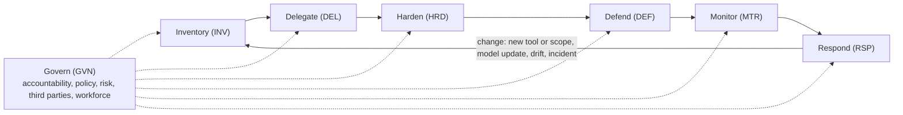

# ACTOR Framework v0.1.0

**AI Controls for Trust, Oversight, and Resilience**

Author: Robert Fernandes.

Licensed under [CC BY 4.0](LICENSE). **Public draft for comment until January 15, 2027.** See [CONTRIBUTING.md](CONTRIBUTING.md) to comment.

ACTOR starts from one premise: AI is a new class of actor. Existing frameworks secure people and conventional systems, and they remain essential. AI fits neither model, so ACTOR adds the controls AI needs and governs the people who use, build, and oversee it.

## Contents

- [Purpose, audience, and thesis](#purpose-audience-and-thesis)
- [Design principles](#design-principles)
- [Definitions and conventions](#definitions-and-conventions)
- [Framework at a glance](#framework-at-a-glance)
- [Govern (GVN)](#govern-gvn)
- [Inventory (INV)](#inventory-inv)
- [Delegate (DEL)](#delegate-del)
- [Harden (HRD)](#harden-hrd)
- [Defend (DEF)](#defend-def)
- [Monitor (MTR)](#monitor-mtr)
- [Respond (RSP)](#respond-rsp)
- [Implementation tiers](#implementation-tiers)
- [Adopting ACTOR alongside your existing program](#adopting-actor-alongside-your-existing-program)
- [Standards mapping](#standards-mapping)

## Purpose, audience, and thesis

ACTOR gives organizations a practical, tool-neutral set of security controls for the full AI estate: agents, models, the data they learn from and read, AI platforms, and how people use AI. The name states the goal. Trust comes from knowing what your AI is and where it came from (Inventory, Harden). Oversight comes from accountability, delegated authority, and monitoring (Govern, Delegate, Monitor). Resilience comes from limiting damage and recovering when AI fails or is manipulated (Defend, Respond).

**Audience.** Any organization that uses, buys, or builds AI and wants to secure it, regardless of size or sector. Implementation tiers let a small organization start with the Foundational controls while larger or more advanced organizations adopt the full set. ACTOR is also written for the MSPs and vCISOs who implement it and the auditors who assess it.

**Thesis.** Current frameworks were designed to secure people and conventional systems. Extending them to AI assumes AI behaves like one or the other. It does not:

- An agent acts like a user, but it is not a person.
- A model runs like software, but its behavior is not deterministic.
- Both can be manipulated through the content they read.
- Both change over time, through drift, model updates, and new tools.

The framework therefore treats AI as its own class of actor. Agents can also go wrong without any attacker, by acting beyond their instructions, so controls assume both manipulation and misbehavior. Agents are security principals, in the identity sense, with their own identity and delegated authority. The term carries no legal meaning of agency. Models and agents have a lifecycle that is governed like a workforce: onboarded, supervised, changed under control, and retired. Agents are the clearest example of this premise, but it applies equally to models and the data that shapes them.

**Scope.** In scope: AI agents, LLMs and other models, the data AI learns from and reads, AI platforms and tool configurations, AI use by the workforce, and third-party AI services.

Out of scope:

- AI used by attackers, such as deepfakes and AI-enabled fraud. Defenses against these belong in existing fraud and social engineering controls.
- Fairness, bias, explainability, and consumer protection topics, including AI disclosure to customers. ACTOR is a security framework and does not address them, except where DEL-AP-04 requires that consequential decisions follow applicable law.
- Model risk management. ACTOR complements, and does not replace, model risk management programs such as those required in financial services.

Using ACTOR alone does not demonstrate compliance with any AI law or regulation. GVN-CO-01 requires organizations to identify the obligations that apply to them.

**Baseline security.** ACTOR assumes foundational security practices, such as MFA, patching, and identity hygiene, are already in place through frameworks such as NIST CSF 2.0 or the CIS Controls. It does not repeat them.

## Design principles

1. **Tool-neutral.** Controls describe outcomes and mechanisms, never a specific product. Product guidance lives in separate implementation notes.
2. **AI as an actor.** Agents get identity, delegated authority, supervision, and offboarding, the same disciplines applied to people.
3. **Least agency.** Grant the minimum data, tools, and autonomy a task needs. Expand only with justification.
4. **Humans hold authority.** Agents hold capability. High-impact actions require a human approval that the agent cannot satisfy.
5. **Assume manipulation and misbehavior.** Any content an AI reads may be hostile, and an agent may act beyond its instructions with no attacker involved. Controls limit what a manipulated or misbehaving AI can do, not only whether it happens.
6. **Know where it came from.** Verify the provenance of models, data, and agents before trusting them. What an AI learns from shapes how it behaves.
7. **Continuous, not point-in-time.** AI behavior changes. Monitoring and evaluation run for the life of the system, and changes trigger re-review.
8. **Plan for failure.** AI and its providers will fail or change without notice. Critical processes keep running, and models, prompts, and data can be rolled back.
9. **Implementable in tiers.** Every control has a tier, so a small organization can start with Foundational controls and grow. No control depends on a control at a higher tier.
10. **Mapped, not isolated.** Controls are designed to map to established frameworks so organizations can reuse existing audits and evidence. v0.1.0 maps at the function level. Control-level mappings follow in v0.2.

## Definitions and conventions

These terms have the following meanings throughout ACTOR.

| Term | Meaning |
| --- | --- |
| AI system | Any system that uses a model to generate content, predictions, or decisions, including AI features embedded in other software. |
| Agent | An AI system that can take actions, such as calling tools, changing data, or sending messages, rather than only producing output for a person to read. |
| Vendor assistant | An agent the vendor builds and runs, such as an AI assistant built into a productivity suite. It is registered once at platform level. |
| Configured agent | An agent a person builds on a vendor platform, such as a custom assistant, low-code agent, or scheduled task. Each one is registered. |
| Built AI system | An AI system or agent the organization develops or hosts itself. Controls that say "the organization builds" apply only to these. |
| AI workload identity | A non-human identity used by an AI system other than an agent, such as a service account for a retrieval or ingestion pipeline, or an API key an application uses to call a model. |
| Session agent | An agent that operates inside a person's signed-in browser, desktop, or terminal session, such as a browser agent, computer-use agent, or local coding agent. |
| In scope | The AI systems the organization has decided ACTOR applies to, recorded in the inventory (INV-AS-01). |
| Approved | Authorized through the organization's documented process, such as the acceptable use policy (GVN-PO-01) or pre-deployment review (GVN-RK-02). |
| Sensitive data | Data the organization classifies as requiring protection, such as personal, confidential, regulated, or secret data. |
| Untrusted content | Any content the organization does not control, including web pages, inbound email, shared or external documents, tool and API output, and user-supplied files. |
| Risk rating | The rating assigned to an AI use case under GVN-RK-01, based on data sensitivity, autonomy, and impact. High risk means the levels the organization's method designates as high risk. |
| Action risk level | The level assigned to a type of agent action under DEL-AP-01. High-impact actions are those at the high or critical level. |
| Implementation tier | Foundational, Managed, or Advanced. Describes the maturity of a control, not the risk of a system. |
| Critical process | A business process whose disruption the organization has determined would cause significant harm, as identified in business continuity planning. |
| Trust boundary | The edge of the systems and people authorized for a given set of data. Data crossing it reaches the outside world or people not authorized for it. |
| Human approval and human review | Approval happens before an action runs (human in the loop). Review happens after it runs (human on the loop). |
| Qualified person | A person the organization designates, by role and training, as able to evaluate a decision and overturn it. |
| Materially affect | A decision that changes a person's access to credit, employment, housing, insurance, education, healthcare, essential services, or legal rights, or as defined by applicable law. |

**Organization-defined values.** Where a control says "at a frequency the organization defines and documents" or "within a time the organization defines," the organization sets the value based on risk rating and records it. Where ACTOR sets a minimum, such as "at least annually," the organization may be stricter but not looser. Where a control names an event, such as a significant change or a modification that meets defined criteria, the organization documents the criteria for that event.

**Every sentence is a requirement.** Each sentence of a control is a requirement and may be tested separately. Controls with lettered parts, such as (a), (b), and (c), are met only when every part is met.

**Absolute requirements.** Where a control says "never," "cannot," "no," or "only," it is met by a configured preventive control plus documented verification at each review of that control.

**Review records.** Every review, test, exercise, and assessment that a control requires is recorded with the date, the people involved, the scope, the findings, and the actions taken. These records are evidence under GVN-CO-03.

**Implementation mode.** Each control is met in one of three ways, and the organization records which one applies to each in-scope system:

- **Operated.** The organization runs the control itself.
- **Configured.** The organization sets a vendor's admin setting and keeps evidence of the setting.
- **Assured.** The vendor provides the control. The organization verifies it through vendor documentation, an independent attestation such as a SOC 2 Type II report or ISO/IEC 27001 or 42001 certificate, contract terms, and a functional test where possible. Assured controls are re-confirmed at each vendor reassessment under GVN-TP-03, or at least annually where that control is not in place.

**Platform limits.** Where a control says "where the platform allows," or a platform cannot meet a control, the organization either does not grant the capability the control protects or records an exception under GVN-RK-03.

**Existing systems and contracts.** AI systems and contracts in place before the organization adopts ACTOR are brought into conformance within a period the organization defines and documents. Gaps during that period are tracked as exceptions under GVN-RK-03.

**Not applicable.** A control may be marked not applicable when its subject does not exist in the organization, for example model training controls where no models are trained. Each not-applicable decision records the rationale and the approver and is reviewed with the inventory. A justified not-applicable control does not prevent a tier claim.

**Conformance.** ACTOR has no certification scheme. Alignment with a tier is self-assessed unless it has been independently assessed under GVN-AC-05. Every tier claim states its type. An "in place" claim means the controls were designed and implemented at a point in time. An "operating" claim means they ran as designed over a period of at least six months, or one full cycle of each periodic control, whichever is longer.

## Framework at a glance

ACTOR has seven functions. Govern sets direction for all of them. The other six run as a loop: any change to an AI system sends it back through the cycle.

This loop is the main structural difference from a checklist. A new tool, a wider scope, a provider model update, detected drift, or an incident triggers re-inventory and re-review, because AI risk changes even when no one touches the configuration.

**Control IDs** follow the pattern FUNCTION-CATEGORY-NN, for example DEL-ID-01. When citing ACTOR next to other frameworks, put the framework name before the ID, as in ACTOR DEL-ID-01, the same way practitioners cite CSF PR.AA-01. The three-letter function codes and hyphenated format avoid collisions with NIST CSF 2.0, SP 800-53, NIST AI 600-1, the CSA AI Controls Matrix, and the Secure Controls Framework.

**Applies to** shows the main subject of each control: Agents, Models, Data (training, retrieval, and memory data), Platforms (AI services and tools), Use (how people use AI), or All.

## Govern (GVN)

Govern sets who is accountable for AI risk, what uses are allowed, and how AI risk is classified. It applies across every other function.

| ID | Control statement | Applies to | Tier |
| --- | --- | --- | --- |
| **GVN-AC Accountability** | | | |
| GVN-AC-01 | A named executive owns AI security risk. AI risk is reported to senior management, and to the board or a board committee where one exists, at a frequency the organization defines and documents. | All | Foundational |
| GVN-AC-02 | Every AI system and agent has a named business owner accountable for its actions and outcomes. | All | Foundational |
| GVN-AC-03 | A cross-functional AI governance group, including security, legal, compliance, privacy, risk, and the business, operates under a documented charter. | All | Managed |
| GVN-AC-04 | AI security metrics and key risk indicators are defined and documented, each with a threshold. They are tracked and included in the AI risk reporting required by GVN-AC-01. | All | Managed |
| GVN-AC-05 | ACTOR controls are independently assessed by internal audit or a qualified third party at a frequency the organization defines and documents. | All | Managed |
| **GVN-PO Policy and acceptable use** | | | |
| GVN-PO-01 | An AI acceptable use policy classifies approved tools by data sensitivity and use case, publishes a sanctioned path for requesting new tools, and defines prohibited uses and data that must not be entered into AI systems. Users acknowledge the policy before they are given access to AI tools. | Use | Foundational |
| GVN-PO-02 | The acceptable use policy prohibits users from giving AI agents their passwords or MFA factors, and from pasting or exporting session cookies, tokens, or personal API keys into AI tools. Agents connect to company systems only as permitted by DEL-ID-01 and DEL-ID-03. | Use | Foundational |
| GVN-PO-03 | AI policy is reviewed at least annually and when a new AI capability is adopted that meets review criteria the organization defines and documents. | All | Managed |
| GVN-PO-04 | AI-enabled security tools that can take actions, such as isolating hosts, disabling accounts, or changing configurations, are recorded in the agent registry and governed under ACTOR like any other agent. Other AI features in security tools are assessed under GVN-TP-01. | Agents | Foundational |
| **GVN-RK Risk classification** | | | |
| GVN-RK-01 | Each AI use case is assigned a risk rating using a documented method with defined levels, based on data sensitivity, level of autonomy, and impact of its actions. The method designates which levels are high risk. | All | Foundational |
| GVN-RK-02 | Each AI system, and each new AI feature in an existing platform, passes a documented pre-deployment review against applicable ACTOR controls before production use. The organization documents which controls apply at each risk rating. High-risk use cases also require a documented risk assessment and approval by a designated approver. | All | Foundational |
| GVN-RK-03 | Exceptions to ACTOR controls and AI policy are approved by the system owner and the executive named under GVN-AC-01, documented with compensating controls, and given an expiry date. Expired exceptions are renewed or closed. | All | Foundational |
| GVN-RK-04 | AI risk appetite and risk thresholds are documented, approved by the executive named under GVN-AC-01, and used to decide exceptions and pre-deployment approvals. | All | Managed |
| **GVN-CO Compliance obligations** | | | |
| GVN-CO-01 | An obligations register records the AI laws, regulations, and sector guidance that apply to each use case. The register is reviewed at least annually and when a use case is added or changed. | All | Foundational |
| GVN-CO-02 | For each AI system, the organization determines its regulatory role, such as provider or deployer, and any risk classification that triggers additional obligations. The role is reassessed when the organization fine-tunes, rebrands, or modifies a model or AI system in a way that meets criteria the organization defines and documents. | All | Foundational |
| GVN-CO-03 | Evidence that AI controls are operating, including approvals, inventories, reviews, tests, and logs, is retained for a period the organization defines and documents that meets legal and regulatory requirements. It can be produced on request for regulators, auditors, and customers. | All | Foundational |
| **GVN-TP Third-party AI** | | | |
| GVN-TP-01 | AI vendors and AI features embedded in existing software are assessed before use, including data use, training on customer data, and retention. Before purchase, the organization confirms the service plan provides the admin audit logs, conversation export, and retention controls its other ACTOR controls rely on. Vendors are rated for criticality, and concentration risk from reliance on a single provider is identified. | Platforms | Foundational |
| GVN-TP-02 | Contracts with AI vendors signed or renewed after the organization adopts ACTOR are checked for (a) data ownership and training on customer data, (b) incident notification, (c) audit rights or independent assurance reports, and regulator access where regulation requires it, (d) access to usage logs and telemetry, (e) data location, (f) return or deletion of data at exit, (g) subcontractor obligations, and (h) responsibility for AI output, including intellectual property indemnity. Where the vendor offers only standard terms, or an existing contract falls short, gaps are recorded as exceptions under GVN-RK-03. | Platforms | Managed |
| GVN-TP-03 | AI vendors are reassessed at least annually, or more often at a frequency the organization defines by criticality. Each vendor rated critical under GVN-TP-01 has a documented exit plan that covers (a) provider shutdown, (b) acquisition, and (c) model deprecation. | Platforms | Managed |
| GVN-TP-04 | AI vendors disclose the model providers and subprocessors behind their service, by contract or by a published list with change notification. The organization subscribes to change notices and reviews changes under GVN-TP-03. | Platforms | Managed |
| **GVN-WF Workforce** | | | |
| GVN-WF-01 | People who use AI are trained before use, and at least annually, on safe use, data handling, and recognizing manipulated or incorrect output. Completion is recorded. | Use | Foundational |
| GVN-WF-02 | Staff who build, administer, or secure AI systems complete role-based training on AI-specific threats and controls before taking on the role and at least annually after that. Completion is recorded. | All | Managed |

## Inventory (INV)

Inventory establishes what AI exists, who owns it, and what it can reach. You cannot delegate, harden, or monitor what you have not found.

| ID | Control statement | Applies to | Tier |
| --- | --- | --- | --- |
| **INV-AS AI asset inventory** | | | |
| INV-AS-01 | A maintained inventory records each AI system, model, agent platform, and AI feature enabled in existing software that processes sensitive data, with owner, purpose, data accessed, and risk rating. It is reconciled at least annually against procurement and expense records, and against discovery results where discovery is in place. Differences are resolved and recorded. | All | Foundational |
| INV-AS-02 | The inventory records model versions, providers, and hosting location for each system. Where a provider does not disclose or fix the model version, the inventory records the product, release channel, and provider-stated model family. | Models | Managed |
| INV-AS-03 | Retired models are removed from service. Weights and associated data the organization holds are disposed of or archived under policy. | Models | Managed |
| **INV-AG Agent registry** | | | |
| INV-AG-01 | Every agent is recorded in an agent registry with owner, purpose, scopes, connected systems, autonomy level, and a named halt authority who can order it stopped. Where the platform issues the agent its own identity, the registry records it. Agents that users build on an approved platform may be registered through the platform's admin inventory if it records owner and connected systems. | Agents | Foundational |
| INV-AG-02 | The registry records each agent's tools, connectors, plugins, and scheduled tasks, as far as the platform exposes them to administrators. | Agents | Foundational |
| **INV-SH Shadow AI discovery** | | | |
| INV-SH-01 | Unapproved AI services, browser extensions, employee-built agents, and models and AI runtimes installed on endpoints are discovered through automated network, endpoint, browser, identity, or SaaS monitoring that runs at least monthly. Discovery includes endpoint checks, because locally run models do not appear in network traffic. Discovery records show which tools are in use and by whom, and, where inline inspection is in place, the data sent to them. Findings are reviewed and resolved. | Use | Managed |
| INV-SH-02 | OAuth grants to AI services in company identity and SaaS platforms, and API keys in company AI provider accounts, code repositories, and secret stores, are discovered and reviewed at a frequency the organization defines and documents. Unapproved or unused grants and keys are revoked. | Platforms | Managed |
| **INV-DF Data flows** | | | |
| INV-DF-01 | For each AI system, the organization documents what data it can read, where prompts and outputs are stored, and how long they are kept. | All | Managed |
| INV-DF-02 | AI systems the organization builds have a bill of materials for models, datasets, and libraries in a standard machine-readable format such as CycloneDX or SPDX. Prompts, tools, and accessible data are recorded in the same document or a linked registry. The bill of materials is updated when any listed component changes. | All | Advanced |

## Delegate (DEL)

Delegate treats agents as principals. Each agent is identifiable as itself, receives only the authority it needs, and cannot take high-impact actions without a human. Delegate consolidates emerging agent identity and authorization guidance into implementable controls.

| ID | Control statement | Applies to | Tier |
| --- | --- | --- | --- |
| **DEL-ID Agent identity** | | | |
| DEL-ID-01 | Each agent accesses company systems through its own identity or through delegated access issued to the agent, such as an OAuth grant to the agent's application, as recorded in the agent registry. No agent is configured with a person's password or MFA factor. No agent uses a person's session cookie or signed-in session, except session agents permitted by DEL-ID-03. | Agents | Foundational |
| DEL-ID-02 | Credentials for agents and other AI workload identities expire within a maximum lifetime the organization defines and documents, and are scoped to the systems and actions recorded in the agent registry or inventory, using workload identity federation, managed identities, or token exchange where the target system supports it. Where only static keys are supported, keys are scoped to the minimum, stored in a secrets manager, and rotated on a documented schedule. Prompts, configuration files, and code are scanned for secrets, and findings are remediated. | All | Managed |
| DEL-ID-03 | Session agents are disabled unless approved through pre-deployment review under GVN-RK-02. Approved session agents are technically limited to approved sites and applications. They do not operate, from the person's own session, on systems the organization designates as sensitive, including financial, administrative, and HR applications. | Agents | Foundational |
| DEL-ID-04 | Session agents that need to reach sensitive systems run in an isolated browser profile, virtual desktop, or vendor-hosted browser with separate sign-ins and no access to the person's own session. | Agents | Managed |
| **DEL-DG Delegation** | | | |
| DEL-DG-01 | Agents acting for a user use delegation, not impersonation. The agent and the user are both recorded in identity provider logs, and in downstream system logs where the downstream system supports it. Where it does not, the AI platform's logs link each action to both. | Agents | Managed |
| DEL-DG-02 | A delegated agent can only do what both the user and the agent are allowed to do. Agents shared with users act with each user's own delegated permissions. An agent that runs under a shared or builder's credential is made available only to people already authorized for everything that credential can reach. Before production use and after scope changes, a test with a restricted account confirms the agent does not reach data or actions that account cannot reach directly. | Agents | Foundational |
| DEL-DG-03 | In multi-agent systems the organization builds or orchestrates, (a) agents authenticate each other using workload identity, such as mutual TLS or signed tokens, before accepting instructions, (b) an agent that hands work to another passes on no more than its own authority, limited to what the task needs, through down-scoped tokens or an equivalent mechanism, (c) the person who authorized the work is recorded at every handoff, and (d) the orchestrator enforces a maximum number of handoffs or steps that the organization defines and documents. Instructions from agents outside the organization's control are treated as untrusted content. | Agents | Advanced |
| DEL-DG-04 | Users cannot grant AI applications or agents access to company systems or data without approval. User consent to third-party apps is restricted to approved apps in the company identity platform. On managed devices, browser extension installation is restricted to approved extensions. API keys in company AI provider accounts are created only by authorized users. | Use | Foundational |
| **DEL-LA Least agency** | | | |
| DEL-LA-01 | Agents receive read-only access by default. Write access is granted per tool, or per connector where the platform does not separate read and write, with a documented justification. | Agents | Foundational |
| DEL-LA-02 | Agent identities hold no permission to change their own roles, scopes, or credentials, or to approve their own access requests. This is confirmed when access is granted and at each review of agent access. | Agents | Foundational |
| DEL-LA-03 | Before an agent automates a process, the process is documented. The documentation identifies the steps that require human approval before they run and the steps that require human review after they run. | Agents | Managed |
| DEL-LA-04 | Agents cannot create scheduled tasks, new credentials, startup items, or copies of models or data outside approved locations unless that capability is approved and recorded in the agent registry, where the platform allows. Persistence that agents create is detected and reviewed. | Agents | Managed |
| **DEL-AP Human approval** | | | |
| DEL-AP-01 | Each type of agent action is assigned an action risk level. The organization defines at least high and critical levels and what an agent may do without approval at each level. High and critical actions require explicit human approval before they run. Where a platform cannot require approval for an action, the agent is not given the tool or permission for that action. | Agents | Foundational |
| DEL-AP-02 | Approvals for high and critical actions are requested on a channel the agent cannot control or read. Critical actions require phishing-resistant re-authentication, such as a FIDO2 security key with user verification. The approval record is bound on the server side to a hash of the exact action and its parameters, and is single-use. Platforms that cannot meet this are not given critical actions. | Agents | Advanced |
| DEL-AP-03 | (a) Each approval authorizes one specific action. Session-wide or standing approval options are disabled where the platform allows, and prohibited by policy where it does not. (b) The approval request shows the action, its target, and its expected impact. (c) Where approval records are available, approval patterns are reviewed for rubber-stamping at a frequency the organization defines and documents, using criteria such as approval time and decline rate, and findings are acted on. | Agents | Managed |
| DEL-AP-04 | For AI-assisted decisions that materially affect people, such as credit, hiring, or access to services, the organization documents the applicable legal requirements on human review, notice, explanation, and appeal, and follows them. Where law sets no requirement, decisions from high-risk use cases are reviewed before they take effect by a person the organization designates as qualified, and other decisions can be appealed to such a person. The principal reasons for each decision are recorded by the reviewer or derived from documented decision factors, not taken only from the model's own explanation, and can be given to the affected person. | All | Foundational |
| **DEL-LC Agent lifecycle** | | | |
| DEL-LC-01 | Access for agents and other AI workload identities is reviewed on the same cadence as privileged accounts, with the owner attesting to each scope. | All | Managed |
| DEL-LC-02 | Agent identities, other AI workload identities, tokens, connectors, and scheduled tasks are removed within a time the organization defines and documents after the agent's purpose ends. When the owner leaves or changes role, shared agents are reassigned or removed within the same time. Where the platform does not expose these items to administrators, deprovisioning the owner's platform account through enterprise identity meets this control. | All | Foundational |

## Harden (HRD)

Harden reduces the attack surface before anything runs: secure platform configuration, a trusted supply chain, protected data with known provenance, and secure development. What a model learns from shapes how it behaves, so training data is gated like any other privileged input.

| ID | Control statement | Applies to | Tier |
| --- | --- | --- | --- |
| **HRD-CF Secure configuration** | | | |
| HRD-CF-01 | Each approved AI platform has a documented secure configuration baseline covering data retention, training opt-out, sharing, connectors, and admin controls. | Platforms | Foundational |
| HRD-CF-02 | AI platforms use enterprise identity (SSO, and SCIM where supported). Tenant-wide AI settings are changed only by named administrators. Building and sharing agents is limited to approved builders, and sharing beyond a team requires approval. Administrative changes are logged, and where the platform does not log them, changes are recorded through change management. | Platforms | Foundational |
| HRD-CF-03 | Configuration is checked against the baseline at a frequency the organization defines and documents, and after vendor releases that add or change data handling, sharing, connector, or admin settings. Deviations are corrected or approved as exceptions. | Platforms | Managed |
| HRD-CF-04 | Self-hosted model endpoints and AI APIs, including development and test instances, require authentication. Network access to them is limited to documented users and systems, and they are not reachable from the internet unless approved. | Platforms | Foundational |
| HRD-CF-05 | New AI features and agents that vendors add to existing platforms are held disabled, or on a restricted release channel, until reviewed under GVN-RK-02, where the platform allows. Where it does not, the feature is reviewed within a time the organization defines and documents after release. | Platforms | Foundational |
| HRD-CF-06 | Endpoint AI agents, such as local coding and desktop agents, are configured through managed policy that users cannot override, covering approval mode, allowed tools and MCP servers, and sandboxing. Agent instruction and configuration files from third-party repositories or workspaces are not loaded without review. | Agents | Managed |
| **HRD-SC Supply chain** | | | |
| HRD-SC-01 | Plugins, extensions, connectors, MCP servers, agent skills, prompt templates, and agent configurations are reviewed for requested permissions and source before installation, or users are limited to an admin-approved catalog. | Agents | Foundational |
| HRD-SC-02 | Locally installed plugins, connectors, and MCP servers are pinned to approved versions and hashes, and updates are reviewed before use. For remote servers that cannot be pinned, tool names and descriptions are recorded at approval and changes are reviewed before use where tooling can detect them. Otherwise the server is reassessed at a frequency the organization defines and documents. | Agents | Managed |
| HRD-SC-03 | Models and datasets come from sources on a documented approved list. Before use, each is verified for origin and integrity, and the verification is recorded. | Models | Managed |
| HRD-SC-04 | Model files and AI dependencies are integrity-checked against published hashes, or signatures where the publisher provides them, and scanned for malicious code. Models are loaded using file formats that cannot execute code, or in isolated environments when that is not possible. | Models | Managed |
| **HRD-DP Data protection** | | | |
| HRD-DP-01 | AI access to data is restricted according to the organization's data classification. The classifications each AI system may access are recorded in the inventory. Where a platform does not enforce classification labels, sources containing restricted data are not connected to it. | All | Managed |
| HRD-DP-02 | AI search and retrieval systems return only content the requesting user can access in the original system. Permissions and deletions are applied at query time or synchronized within a time the organization defines and documents. Sources whose permissions the platform cannot honor are not connected, or are limited to content every user may see. This is confirmed before enablement by a test with a restricted account. | All | Foundational |
| HRD-DP-03 | A privacy impact assessment, or a data protection impact assessment where law requires one, is completed for AI use cases that process personal data and confirms a lawful basis for the processing. | All | Foundational |
| HRD-DP-04 | Retention periods for prompts, outputs, and AI logs are documented and meet legal, regulatory, business, and investigation requirements. (a) Legal holds override deletion, using platform eDiscovery or compliance export where available. (b) Deletion requests are honored within the time set by law or policy across logs, retrieval stores, and fine-tuning data the organization controls, and vendor retention, including abuse-monitoring retention, is confirmed under GVN-TP-01. (c) Where data cannot be removed from a trained model, the limitation is documented, and the model is retrained or retired when law, contract, or a documented risk decision requires it. | All | Managed |
| HRD-DP-05 | Before AI tools that search or summarize company data are enabled, permissions on files, sites, and mailboxes within their reach are reviewed against criteria for overshared access that the organization defines and documents. Findings are remediated or accepted as risks before enablement. The review is repeated at a frequency the organization defines and documents. | Platforms | Foundational |
| HRD-DP-06 | Technical controls warn on or block sensitive data sent to unapproved AI tools, using documented rules that enforce the acceptable use policy. | Use | Managed |
| HRD-DP-07 | Access to approved AI services from company devices and networks is limited to the company's own tenant or account, using tenant restrictions, network security controls, or enterprise browser policy, so personal accounts on the same services cannot be used with company data. | Use | Managed |
| HRD-DP-08 | Derived AI data, including embeddings, vector indexes, prompt and response caches, conversation history, and agent memory, inherits the highest classification of its sources. It is access-controlled, encrypted, separated by tenant or user where shared, and included in the data inventory and in deletion requests. | Data | Managed |
| **HRD-PV Data provenance** | | | |
| HRD-PV-01 | Providers of models, datasets, and agents are asked for provenance documentation, such as model cards, data sheets, attestations, or an AI bill of materials, which is reviewed before acquisition or first use. Gaps are recorded as risks. | All | Foundational |
| HRD-PV-02 | Every dataset used to train, fine-tune, or evaluate a model has a recorded source, owner, usage rights, and collection date. | Data | Managed |
| HRD-PV-03 | New training, fine-tuning, and evaluation data passes a documented intake gate before use. The gate checks for anomalous or duplicate samples, embedded instructions, known poisoning patterns, sensitive data, and prohibited content, and records each result. Data from public or untrusted sources is quarantined until it passes. | Data | Managed |
| HRD-PV-04 | Datasets are versioned and integrity-protected with hashes or signatures, and lineage is tracked from source through each transformation to the model version it produced, so the exact data behind any model can be reproduced. | Data | Advanced |
| **HRD-MP Model protection** | | | |
| HRD-MP-01 | Model weights and fine-tuned models are access-controlled and encrypted at rest. For provider-hosted fine-tuned models, access is restricted through the provider's access controls, and customer-managed keys are used where offered. | Models | Managed |
| **HRD-DV Secure development** | | | |
| HRD-DV-01 | System prompts, agent instructions, and agent tool configurations are version-controlled and changed through review. Where the platform has no version history, configurations are exported or recorded before each change. | Agents | Managed |
| HRD-DV-02 | Internally built AI systems follow a secure development lifecycle that includes threat modeling for AI-specific threats. | All | Managed |
| HRD-DV-03 | All code, including AI-generated code, goes through the same review, testing, and scanning before merge. Automated checks confirm that each new dependency exists in an approved package registry and comes from a trusted source. | Use | Foundational |
| HRD-DV-04 | System prompts contain no credentials, secrets, or sensitive data. Access control, authorization, and other security decisions are enforced outside the model and do not depend on the system prompt staying confidential. System prompts are reviewed for this before deployment. | Agents | Foundational |
| HRD-DV-05 | MCP servers and other tool servers the organization exposes authenticate each client, accept only tokens issued for that server, never pass client tokens through to downstream systems, and authorize each tool call for the calling user or agent. | Agents | Managed |

## Defend (DEF)

Defend protects AI while it runs. It assumes manipulation will sometimes succeed, so it limits what a manipulated model or agent can reach and do.

| ID | Control statement | Applies to | Tier |
| --- | --- | --- | --- |
| **DEF-IN Input protection** | | | |
| DEF-IN-01 | An agent that reads untrusted content does not hold high-impact write tools, or tools that send data outside the organization, in the same session unless human approval gates those tools. Rendering external links or images in output counts as sending data out. For vendor assistants, the organization disables the combinations it can control, such as web access or external connectors, for high-risk users and use cases, and relies for the rest on the vendor's documented exfiltration protections, confirmed under GVN-TP-01. | Agents | Foundational |
| DEF-IN-02 | Untrusted content, such as web pages, email, documents, and tool output, is marked as data, delimited from instructions, and never placed in system or developer instructions. In agents the organization builds, designs that stop untrusted content from changing the agent's plan or tool choice are used where feasible. Because no current method fully separates data from instructions, DEF-IN-01 applies. | All | Managed |
| DEF-IN-03 | Inputs to AI systems the organization builds that handle sensitive data or hold tools are screened for prompt injection using detection rules or classifiers. Detection and false-positive rates are measured against a test set at a frequency the organization defines and documents. For vendor platforms, the vendor's injection protections are confirmed under GVN-TP-01 and enabled where configurable. | All | Managed |
| **DEF-OU Output handling** | | | |
| DEF-OU-01 | Systems the organization builds or integrates validate model output before executing, rendering, or storing it, using documented checks such as output encoding, schema validation, allowlists, and parameterized queries. | All | Foundational |
| DEF-OU-02 | Output from AI systems that can access sensitive data is screened with documented detection rules before it leaves the organization or reaches users not authorized for that data, using data loss prevention in the AI gateway, the platform, or the channel the output is sent through. | All | Managed |
| DEF-OU-03 | Customer-facing AI output is filtered against a documented content policy that defines harmful, prohibited, and off-policy content. Filter actions are logged. | All | Foundational |
| **DEF-TL Tool and action enforcement** | | | |
| DEF-TL-01 | Agent network egress is restricted to approved destinations. For agents that run on vendor infrastructure, web access is disabled or limited to approved domains where the platform allows, and the remaining exposure is recorded in the risk rating. | Agents | Managed |
| DEF-TL-02 | Documented rate and spending limits are technically enforced through provider quotas, project budgets, or an AI gateway to cap runaway or abusive consumption. Where a provider only alerts, the alert triggers the halt mechanism in DEF-TL-06. | All | Managed |
| DEF-TL-03 | Tool calls of agents the organization builds, or whose tools it hosts, pass through a policy enforcement point that checks each action against the agent's scope and the action's risk level. | Agents | Advanced |
| DEF-TL-04 | Models the organization exposes to external users through an API or application have per-client authentication, quotas, and rate limits. Query volume and pattern anomalies that may indicate model extraction or inversion are monitored and throttled. | Models | Advanced |
| DEF-TL-05 | Code that an agent runs on its own executes in an isolated environment, such as a vendor sandbox, container, or virtual machine. Local agents use the tool's sandbox or require approval for each command, and are not given administrator rights or access to production credentials on the workstation. | Agents | Foundational |
| DEF-TL-06 | (a) Every agent can be stopped within a time the organization defines and documents, through a platform kill switch, disabling the agent or its connectors, or revoking its credentials. (b) Step, loop, or run-time limits, documented for each agent, stop runaway agents automatically, configured where the platform allows and confirmed in vendor documentation where it does not. (c) Agents in high-risk use cases stop, or are restricted to read-only, when monitoring they rely on fails or a control failure is detected, where the platform allows. (d) The halt is demonstrated by test at least annually. | Agents | Foundational |
| **DEF-PS Poisoning and manipulation defenses** | | | |
| DEF-PS-01 | Only authorized contributors can add content to curated AI knowledge sources, such as agent knowledge bases and retrieval indexes, or change training and fine-tuning data, and every change is logged and attributable. For assistants that search the general content estate, source-system permissions and HRD-DP-05 apply. | Data | Managed |
| DEF-PS-02 | Content ingested into retrieval stores the organization builds is tagged with its source and trust level, so retrieval filters and downstream controls can exclude or restrict untrusted content. | Data | Managed |
| DEF-PS-03 | Agent long-term memory is scoped to a user or task, and its owner can view and delete it. In agents the organization builds, memory writes from untrusted content pass documented validation or require user confirmation. On vendor platforms that cannot do this, memory is disabled for high-risk use cases. | Agents | Managed |
| DEF-PS-04 | User feedback, ratings, and conversation data are checked for manipulation before they are used to retrain or tune a model. Checks use documented criteria, such as volume anomalies and coordinated submissions, and results are recorded. | Models | Advanced |

## Monitor (MTR)

Monitor watches AI for the life of the system. It covers logging, agent behavior baselines, model drift, vulnerability management, and ongoing adversarial testing.

| ID | Control statement | Applies to | Tier |
| --- | --- | --- | --- |
| **MTR-LG Logging** | | | |
| MTR-LG-01 | Agent actions, tool calls, approvals, and the acting identity are logged, with retention that meets legal, regulatory, and incident response requirements. For vendor platforms, the organization enables the platform's audit logging, confirms what it captures, exports logs where platform retention is too short, and records gaps as risks. | Agents | Foundational |
| MTR-LG-02 | Prompts and outputs are logged for AI systems the organization designates by risk rating, and the designation is documented. These logs receive the access controls and encryption required for the most sensitive data they may contain. | All | Managed |
| MTR-LG-03 | AI logs feed the central SIEM and are correlated with target-system logs. Agent actions are distinguished from human actions where identity data allows, and gaps are recorded. | All | Managed |
| MTR-LG-04 | In agents the organization builds, logs carry trace IDs, such as W3C Trace Context, that link the authorizing person to the agent and to each step and tool call, including across agent-to-agent handoffs within systems the organization controls. | Agents | Advanced |
| MTR-LG-05 | Agents cannot read, change, or disable the logs and monitors that observe them. Agent logs are written to storage the agent's identity cannot modify, and monitoring treats agent output as possibly crafted to evade or exploit the monitor. | Agents | Managed |
| **MTR-BH Behavior baselines** | | | |
| MTR-BH-01 | Documented detection rules alert on indicators of manipulation, such as unexpected resources, scope creep, and unprompted requests for sensitive data. Rule effectiveness is reviewed at a frequency the organization defines and documents. | Agents | Managed |
| MTR-BH-02 | Each agent has a documented behavior baseline covering systems accessed, volume, timing, and tools. Deviations beyond documented thresholds generate alerts. | Agents | Advanced |
| MTR-BH-03 | AI security alerts are routed to the security operations function with defined triage and escalation procedures. | All | Managed |
| **MTR-DR Drift and integrity** | | | |
| MTR-DR-01 | Provider model changes are tracked as change events. Where a provider allows model versions to be pinned, they are pinned and changed through review. Where it does not, provider release notes are monitored and changes are reviewed according to the system's risk rating. | Models | Foundational |
| MTR-DR-02 | Production models the organization deploys or pins are evaluated against a defined test set at a frequency the organization defines and documents. After any model, training, or data update, the model passes the same evaluation before release to production. For vendor-managed models that change without notice, the test set is run after announced changes and on a documented schedule. | Models | Managed |
| MTR-DR-03 | Thresholds for accuracy, safety, and output quality are defined for the MTR-DR-02 test set. A breach triggers review, and rollback where the model version is under the organization's control. | Models | Managed |
| MTR-DR-04 | Retrieval stores, agent memory, and training data that the organization controls are scanned for injected instructions or anomalous content at a frequency the organization defines and documents, and unexpected changes generate alerts. | Data | Managed |
| **MTR-VM Vulnerability and threat management** | | | |
| MTR-VM-01 | Vulnerabilities in AI frameworks, models, and libraries are tracked and remediated on defined timelines. | All | Managed |
| MTR-VM-02 | AI threat intelligence, such as MITRE ATLAS techniques, is reviewed at a frequency the organization defines and documents. Each review records relevant threats and the resulting control changes, or the decision that none are needed. | All | Managed |
| **MTR-TS Testing and reporting** | | | |
| MTR-TS-01 | Employees and customers have a documented, published channel to report suspicious, unexpected, or harmful AI behavior. Reports are logged and triaged. Customer reports feed the complaint management process. | Use | Foundational |
| MTR-TS-02 | Customer-facing and tool-using AI systems are tested for prompt injection, data leakage, and excessive agency before production release and after changes that meet criteria the organization defines and documents. For vendor platforms, testing covers the organization's configuration, connectors, and agents, within the vendor's published testing rules. Findings are tracked to remediation. | All | Managed |
| MTR-TS-03 | Independent red teams, internal or external, test AI systems adversarially at a frequency based on risk rating that the organization defines and documents. | All | Advanced |

## Respond (RSP)

Respond adapts incident response to AI. The evidence is prompts, context, and tool calls. Containment means revoking agent authority and rolling back models, prompts, or data. Respond also keeps critical processes running when AI is unavailable.

| ID | Control statement | Applies to | Tier |
| --- | --- | --- | --- |
| **RSP-PL Preparation** | | | |
| RSP-PL-01 | The incident response plan defines AI incidents, including manipulation, data leakage, harmful agent actions, agent actions taken beyond their instructions, and model compromise. It defines near-misses and severity criteria for both, and near-misses are recorded and reviewed. | All | Foundational |
| RSP-PL-02 | AI incident scenarios, including halting a misbehaving agent, are exercised in tabletops at least annually. | All | Managed |
| **RSP-IV Investigation** | | | |
| RSP-IV-01 | Investigators can reconstruct an AI incident from prompts, outputs, retrieved content, tool calls, and approvals, to the extent the platform records them. Gaps in what platforms record are identified before an incident and recorded as risks. Reconstruction is demonstrated at least annually in an exercise or a real investigation. | All | Managed |
| RSP-IV-02 | Evidence collection covers AI artifacts, including model and dataset versions, system prompts, agent configurations and memory, retrieval sources, and vendor logs, where available, and preserves them before rollback or deletion. | All | Managed |
| **RSP-CN Containment and recovery** | | | |
| RSP-CN-01 | Runbooks cover containment, including invoking the halt mechanism, revoking agent tokens, disabling tools and connectors, pausing scheduled tasks, and blocking AI services. Any agent can be disabled without disabling the account of the person who owns or uses it, by disabling the agent, its connectors, or the AI feature for that user. Where a platform cannot do this, the runbook states the fallback. | Agents | Foundational |
| RSP-CN-02 | AI assets the organization controls, including models, configurations, system prompts, retrieval indexes, and agent memory, are versioned and backed up, and can be rolled back to a known-good version or restored within defined recovery objectives. Restoration is demonstrated by test at least annually. | All | Managed |
| RSP-CN-03 | A documented procedure identifies poisoned data and removes it from datasets, retrieval stores, and memory, traces it to affected models and outputs, rolls back or retrains affected models, and assesses downstream effects. The procedure is exercised at least annually. | Data | Advanced |
| RSP-CN-04 | A halted or contained agent resumes only after the cause is addressed and its monitoring, logging, halt mechanism, and permission limits are verified to work. The owner documents the resume decision and remaining risks. Agents built or configured the same way are checked for the same failure. | Agents | Foundational |
| **RSP-BC Business continuity** | | | |
| RSP-BC-01 | Critical processes that depend on AI are identified with recovery objectives. Each has documented fallback procedures for when the AI or its provider is unavailable, and named people trained to run them. | All | Foundational |
| RSP-BC-02 | Fallback procedures are tested at least annually, including a provider outage and a forced model change. | All | Managed |
| **RSP-IM Improvement and notification** | | | |
| RSP-IM-01 | Legal and compliance determine whether an AI incident must be reported to regulators, customers, vendors, or other parties whose systems an agent affected, under law and contract. Notifications meet the shortest applicable deadline, and notification decisions are documented. | All | Foundational |
| RSP-IM-02 | After each AI incident and exercise, a lessons-learned review is recorded within a time the organization defines and documents. Resulting updates to controls, baselines, risk ratings, and evaluation test sets are tracked to completion. | All | Managed |

## Implementation tiers

Every control carries a tier, so organizations adopt the framework in stages. v0.1.0 has 122 controls: 49 Foundational, 62 Managed, and 11 Advanced.

| Tier | Intended for | What it achieves |
| --- | --- | --- |
| Foundational | Every organization using AI, including small firms with an IT administrator or MSP but no dedicated security staff | Ownership, acceptable use, an inventory, an exception process, agents off shared credentials, controlled session agents, new vendor AI features held for review, human approval for high-impact actions, basic logging, retained evidence, a tested halt mechanism, an AI-aware incident plan, and fallbacks for when AI is unavailable |
| Managed | Organizations with a security function or an MSP or vCISO partner | Delegation instead of impersonation, configuration baselines, injection and output defenses, model integrity checks, tenant restrictions, protection of derived AI data, managed endpoint agents, SIEM integration, drift evaluation with quality thresholds, pre-release testing, and backup and rollback |
| Advanced | Organizations building their own AI systems or running high-autonomy agents | Hardware-bound approvals, policy enforcement on every tool call, behavior baselines, trace IDs across agents, dataset lineage, multi-agent delegation controls, and independent red teaming |

Tiers are cumulative. An organization claims a tier only when every control at that tier and below is in place for in-scope systems, or is justified as not applicable. Tier selection depends on the organization's risk, not only its size. Regulated organizations should expect to need many Managed controls.

## Adopting ACTOR alongside your existing program

ACTOR is an overlay. It is designed to be added to the framework an organization already uses, such as NIST CSF 2.0, ISO/IEC 27001, or the CIS Controls, not run as a separate program. Three tools keep the effort proportional.

**ACTOR Essentials.** A starting set of 18 Foundational controls that remove the most AI risk for an organization that mainly uses vendor AI. Essentials is a starting point, not a tier. Claiming the Foundational tier still requires every Foundational control.

| ID | What it achieves |
| --- | --- |
| GVN-AC-02 | Someone owns every AI system and agent. |
| GVN-PO-01 | People know which AI tools are approved and what data stays out. |
| GVN-TP-01 | AI vendors are checked before data reaches them. |
| GVN-WF-01 | People who use AI know the risks. |
| INV-AS-01 | You know what AI is in use. |
| INV-AG-01 | You know which agents can act, and who can stop them. |
| DEL-ID-01 | Agents never use people's passwords or sessions. |
| DEL-ID-03 | Browser, desktop, and coding agents are off until approved. |
| DEL-DG-04 | Users cannot connect AI apps to company data on their own. |
| DEL-AP-01 | A person approves high-impact agent actions. |
| HRD-CF-01 | Each AI platform has a secure baseline configuration. |
| HRD-CF-05 | New vendor AI features stay off until reviewed. |
| HRD-DP-02 | AI search only shows people what they could already open. |
| HRD-DP-05 | Overshared files are fixed before AI search is turned on. |
| DEF-IN-01 | Agents that read untrusted content cannot also act or send data out freely. |
| DEF-TL-06 | Every agent can be stopped quickly, and the stop is tested. |
| MTR-LG-01 | Agent actions and approvals are logged. |
| RSP-PL-01 | The incident response plan covers AI incidents. |

**Deployment profiles.** Organizations select every profile that describes them. A control applies when the organization has any profile the control lists. Controls outside the organization's profiles are not applicable and need no separate rationale.

| Profile | Description | Controls that apply |
| --- | --- | --- |
| Consumed | Uses vendor AI products as delivered, such as AI assistants in productivity suites, chat assistants, and AI features in existing software | 91 |
| Configured | Also builds agents, assistants, knowledge bases, or workflows on a vendor platform | 101 |
| Built | Also develops or hosts its own AI systems, including applications on model APIs, retrieval pipelines, self-hosted models, and tool servers | 122 |

An organization that only consumes vendor AI has 91 applicable controls, 46 of them Foundational.

**New and Extends.** Each control is marked as New, meaning AI-specific work with no usual equivalent, or Extends, meaning it adds AI scope to a practice most security programs already run. For a Consumed organization, 67 of its 91 applicable controls extend existing practices, and 29 of its 46 Foundational controls do. Extends controls are best implemented by updating the existing policy, procedure, or control rather than creating a new one.

| Existing practice | ACTOR controls that extend it |
| --- | --- |
| Acceptable use policy | GVN-PO-01, GVN-PO-02, GVN-PO-03 |
| Asset inventory | GVN-AC-02, INV-AS-01, INV-AS-02, INV-AS-03, INV-SH-01 |
| Business continuity and disaster recovery | RSP-CN-02, RSP-BC-01, RSP-BC-02 |
| Change management | MTR-DR-01 |
| Compliance management | GVN-CO-01, GVN-CO-03 |
| Data protection | INV-DF-01, HRD-DP-01, HRD-DP-04, HRD-DP-06, HRD-DP-07, HRD-DP-08, HRD-MP-01, DEF-OU-02 |
| Identity and access management | INV-SH-02, DEL-ID-02, DEL-DG-04, DEL-LA-01, DEL-LA-02, DEL-LC-01, DEL-LC-02, HRD-CF-02 |
| Incident response | MTR-TS-01, RSP-PL-01, RSP-PL-02, RSP-IV-01, RSP-IV-02, RSP-CN-01, RSP-IM-01, RSP-IM-02 |
| Internal audit and assurance | GVN-AC-05 |
| Logging and monitoring | MTR-LG-01, MTR-LG-02, MTR-LG-03, MTR-LG-05, MTR-BH-01, MTR-BH-03 |
| Network security | DEF-TL-01 |
| Privacy program | HRD-DP-03 |
| Risk management and exceptions | GVN-RK-01, GVN-RK-02, GVN-RK-03, GVN-RK-04 |
| Secure configuration management | HRD-CF-01, HRD-CF-03, HRD-CF-04, HRD-CF-06 |
| Secure development lifecycle | HRD-DV-01, HRD-DV-02, HRD-DV-03, HRD-DV-05, DEF-OU-01 |
| Security awareness and training | GVN-WF-01, GVN-WF-02 |
| Security governance and reporting | GVN-AC-01, GVN-AC-03, GVN-AC-04 |
| Security testing | MTR-TS-02, MTR-TS-03 |
| Software supply chain security | INV-DF-02, HRD-SC-01, HRD-SC-02, HRD-SC-03, HRD-SC-04 |
| Third-party risk management | GVN-TP-01, GVN-TP-02, GVN-TP-03, GVN-TP-04, HRD-PV-01 |
| Threat intelligence | MTR-VM-02 |
| Vulnerability management | MTR-VM-01 |

New controls: GVN-PO-04, GVN-CO-02, INV-AG-01, INV-AG-02, DEL-ID-01, DEL-ID-03, DEL-ID-04, DEL-DG-01, DEL-DG-02, DEL-DG-03, DEL-LA-03, DEL-LA-04, DEL-AP-01, DEL-AP-02, DEL-AP-03, DEL-AP-04, HRD-CF-05, HRD-DP-02, HRD-DP-05, HRD-PV-02, HRD-PV-03, HRD-PV-04, HRD-DV-04, DEF-IN-01, DEF-IN-02, DEF-IN-03, DEF-OU-03, DEF-TL-02, DEF-TL-03, DEF-TL-04, DEF-TL-05, DEF-TL-06, DEF-PS-01, DEF-PS-02, DEF-PS-03, DEF-PS-04, MTR-LG-04, MTR-BH-02, MTR-DR-02, MTR-DR-03, MTR-DR-04, RSP-CN-03, RSP-CN-04.

The control data files carry these as the relation, extends, profiles, and essentials fields.

## Standards mapping

v0.1.0 maps at the function level. Control-level mappings follow in v0.2. Mappings are informative. They show topical alignment, not equivalence, and meeting an ACTOR control does not by itself satisfy a mapped requirement. OWASP references use the 2025 LLM Top 10 numbering and will be updated to the 2026 edition in v0.2.

| Function | NIST CSF 2.0 | NIST AI RMF | OWASP LLM Top 10 (2025) |
| --- | --- | --- | --- |
| Govern (GVN) | Govern (GV), including supply chain risk (GV.SC) | Govern | Supports all |
| Inventory (INV) | Identify (ID.AM asset management) | Map | LLM03 Supply Chain |
| Delegate (DEL) | Protect (PR.AA identity and access) | Manage | LLM06 Excessive Agency |
| Harden (HRD) | Protect (PR.PS platform security, PR.DS data security) | Manage | LLM03 Supply Chain, LLM04 Data and Model Poisoning, LLM07 System Prompt Leakage, LLM08 Vector and Embedding Weaknesses |
| Defend (DEF) | Protect (PR.DS), Detect (DE) | Manage | LLM01 Prompt Injection, LLM02 Sensitive Information Disclosure, LLM05 Improper Output Handling, LLM10 Unbounded Consumption |
| Monitor (MTR) | Detect (DE.CM continuous monitoring) | Measure | LLM01 Prompt Injection, LLM09 Misinformation |
| Respond (RSP) | Respond (RS), Recover (RC) | Manage | Supports all |

Planned for v0.2: control-level mappings to the NIST Cyber AI Profile (IR 8596), NIST COSAiS overlays, the CSA AI Controls Matrix, ISO/IEC 42001, MITRE ATLAS, the ISACA AAISM job practice, the EU AI Act, NIST's key practices for AI incident readiness and response, the OWASP Agent Control Standard (ACS), the SANS Critical AI Security Guidelines, the SANS AI Security Maturity Model, and the AI Defense Matrix. The Delegate function will also be aligned with the NIST NCCoE Software and AI Agent Identity and Authorization project as it matures.
