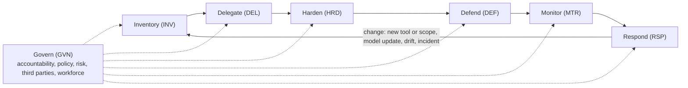

# ACTOR Framework v0.1.0

**AI Controls for Trust, Oversight, and Resilience**

Author: Robert Fernandes. Licensed under [CC BY 4.0](LICENSE).

**Confidential draft for private review. Not for distribution.** Suggestions shared with the author may be incorporated into ACTOR and released under CC BY 4.0.

ACTOR starts from one premise: AI is a new class of actor. Existing frameworks secure people and conventional systems, and they remain essential. AI fits neither model, so ACTOR adds the controls AI needs and governs the people who use, build, and oversee it.

## Contents

- [Purpose, audience, and thesis](#purpose-audience-and-thesis)
- [Design principles](#design-principles)
- [Framework at a glance](#framework-at-a-glance)
- [Govern (GVN)](#govern-gvn)
- [Inventory (INV)](#inventory-inv)
- [Delegate (DEL)](#delegate-del)
- [Harden (HRD)](#harden-hrd)
- [Defend (DEF)](#defend-def)
- [Monitor (MTR)](#monitor-mtr)
- [Respond (RSP)](#respond-rsp)
- [Implementation tiers](#implementation-tiers)
- [Standards mapping](#standards-mapping)

## Purpose, audience, and thesis

ACTOR gives organizations a practical, tool-neutral set of security controls for the full AI estate: agents, models, the data they learn from and read, AI platforms, and how people use AI. The name states the goal. Trust comes from knowing what your AI is and where it came from (Inventory, Harden). Oversight comes from accountability, delegated authority, and monitoring (Govern, Delegate, Monitor). Resilience comes from limiting damage and recovering when AI fails or is manipulated (Defend, Respond).

**Audience.** Any organization that uses, buys, or builds AI and wants to secure it, regardless of size or sector. Implementation tiers let a small organization start with the Foundational controls while larger or more advanced organizations adopt the full set. ACTOR is also written for the MSPs, vCISOs, and auditors who implement and assess it for others.

**Thesis.** Current frameworks were designed to secure people and conventional systems. Extending them to AI assumes AI behaves like one or the other. It does not:

- An agent acts like a user, but it is not a person.
- A model runs like software, but its behavior is not deterministic.
- Both can be manipulated through the content they read.
- Both change over time, through drift, model updates, and new tools.

The framework therefore treats AI as its own class of actor. Agents are principals with their own identity and delegated authority. Models and agents have a lifecycle that is governed like a workforce: onboarded, supervised, changed under control, and retired. Agents are the clearest example of this premise, but it applies equally to models and the data that shapes them.

**Scope.** In scope: AI agents, LLMs and other models, AI platforms and tool configurations, AI use by the workforce, and third-party AI services. Out of scope: AI used by attackers, such as deepfakes and AI-enabled social engineering (covered only where it changes a defensive control), and ethics or fairness topics outside security.

**Baseline security.** ACTOR assumes foundational security practices, such as MFA, patching, and identity hygiene, are already in place through frameworks such as NIST CSF 2.0 or the CIS Controls. It does not repeat them.

## Design principles

1. **Tool-neutral.** Controls describe outcomes and mechanisms, never a specific product. Product guidance lives in separate implementation notes.
2. **AI as an actor.** Agents get identity, delegated authority, supervision, and offboarding, the same disciplines applied to people.
3. **Least agency.** Grant the minimum data, tools, and autonomy a task needs. Expand only with justification.
4. **Humans hold authority.** Agents hold capability. High-impact actions require a human approval that the agent cannot satisfy.
5. **Assume manipulation.** Any content an AI reads may be hostile. Controls limit what a manipulated AI can do, not only whether it gets manipulated.
6. **Know where it came from.** Verify the provenance of models, data, and agents before trusting them. What an AI learns from shapes how it behaves.
7. **Continuous, not point-in-time.** AI behavior changes. Monitoring and evaluation run for the life of the system, and changes trigger re-review.
8. **Plan for failure.** AI and its providers will fail or change without notice. Critical processes keep running, and models, prompts, and data can be rolled back.
9. **Implementable in tiers.** Every control has a tier, so a small organization can start with Foundational controls and grow.
10. **Mapped, not isolated.** Every control maps to established frameworks so organizations can reuse existing audits and evidence.

## Framework at a glance

ACTOR has seven functions. Govern sets direction for all of them. The other six run as a loop: any change to an AI system sends it back through the cycle.

This loop is the main structural difference from a checklist. A new tool, a wider scope, a provider model update, detected drift, or an incident triggers re-inventory and re-review, because AI risk changes even when no one touches the configuration.

**Control IDs** follow the pattern FUNCTION-CATEGORY-NN, for example DEL-ID-01. When citing ACTOR next to other frameworks, put the framework name before the ID, as in ACTOR DEL-ID-01, the same way practitioners cite CSF PR.AA-01. The three-letter function codes and hyphenated format avoid collisions with NIST CSF 2.0, SP 800-53, NIST AI 600-1, the CSA AI Controls Matrix, and the Secure Controls Framework.

**Applies to** shows the main subject of each control: Agents, Models, Platforms (AI services and tools), Use (how people use AI), or All.

## Govern (GVN)

Govern sets who is accountable for AI risk, what uses are allowed, and how AI risk is classified. It applies across every other function.

| ID | Control statement | Applies to | Tier |
| --- | --- | --- | --- |
| **GVN-AC Accountability** | | | |
| GVN-AC-01 | A named executive owns AI security risk. AI risk is reported to leadership on a defined cadence. | All | Foundational |
| GVN-AC-02 | Every AI system and agent has a named business owner accountable for its actions and outcomes. | All | Foundational |
| GVN-AC-03 | A cross-functional AI governance group, including security, legal, privacy, risk, and the business, operates under a documented charter. | All | Managed |
| GVN-AC-04 | AI security metrics and key risk indicators are defined, tracked, and reported with AI risk. | All | Managed |
| GVN-AC-05 | ACTOR controls are independently assessed on a defined cadence by internal audit or a qualified third party. | All | Managed |
| **GVN-PO Policy and acceptable use** | | | |
| GVN-PO-01 | An AI acceptable use policy classifies approved tools by data sensitivity and use case, publishes a sanctioned path for requesting new tools, and defines prohibited uses and data that must not be entered into AI systems. | Use | Foundational |
| GVN-PO-02 | Users do not give AI agents their passwords, session cookies, MFA tokens, or personal API keys. Agents connect to company systems only through approved, delegated access that meets the Delegate (DEL) controls. | Agents | Foundational |
| GVN-PO-03 | AI policy is reviewed at least annually and whenever a significant new AI capability is adopted. | All | Managed |
| GVN-PO-04 | AI-enabled security tools are inventoried and governed under ACTOR like any other agent. | Agents | Foundational |
| **GVN-RK Risk classification** | | | |
| GVN-RK-01 | Each AI use case is assigned a risk tier based on data sensitivity, level of autonomy, and impact of its actions. | All | Foundational |
| GVN-RK-02 | Higher-risk use cases require a documented risk assessment and approval before deployment. | All | Managed |
| GVN-RK-03 | AI risk appetite and thresholds are defined. Exceptions are approved, documented, and time-limited. | All | Managed |
| GVN-RK-04 | Every AI system passes a pre-deployment review against applicable ACTOR controls before production use, scaled to its risk tier. | All | Foundational |
| **GVN-CO Compliance obligations** | | | |
| GVN-CO-01 | An obligations register tracks the AI laws, regulations, and sector guidance that apply to each use case, and is reviewed as requirements change. | All | Foundational |
| GVN-CO-02 | For each AI system, the organization determines its regulatory role, such as provider or deployer, and any risk classification that triggers additional obligations. | All | Managed |
| GVN-CO-03 | Evidence that AI controls are operating, including approvals, inventories, assessments, and logs, is retained and can be produced on request for regulators, auditors, and customers. | All | Managed |
| **GVN-TP Third-party AI** | | | |
| GVN-TP-01 | AI vendors and AI features embedded in existing software are assessed before use, including data use, training on customer data, and retention. | Platforms | Foundational |
| GVN-TP-02 | Contracts address data ownership, training on customer data, incident notification, audit rights, and access to usage logs and telemetry. | Platforms | Managed |
| GVN-TP-03 | AI vendors are reassessed periodically, and an exit plan covers provider shutdown, acquisition, or model deprecation. | Platforms | Managed |
| GVN-TP-04 | AI vendors disclose the model providers and subprocessors behind their service and give notice before changing them. | Platforms | Managed |
| **GVN-WF Workforce** | | | |
| GVN-WF-01 | People who use AI are trained on safe use, data handling, and recognizing manipulated or incorrect output. | Use | Foundational |
| GVN-WF-02 | Developers, administrators, and security staff receive role-based training on AI-specific threats and controls. | All | Managed |

## Inventory (INV)

Inventory establishes what AI exists, who owns it, and what it can reach. You cannot delegate, harden, or monitor what you have not found.

| ID | Control statement | Applies to | Tier |
| --- | --- | --- | --- |
| **INV-AS AI asset inventory** | | | |
| INV-AS-01 | An inventory lists every AI system, model, and AI feature in use, with owner, purpose, data accessed, and risk tier. | All | Foundational |
| INV-AS-02 | The inventory records model versions, providers, and hosting location for each system. | Models | Managed |
| INV-AS-03 | Retired models are removed from service, and their weights and associated data are disposed of or archived under policy. | Models | Managed |
| **INV-AG Agent registry** | | | |
| INV-AG-01 | Every agent is registered as a non-human identity with owner, purpose, scopes, connected systems, autonomy level, and a named halt authority with a documented halt procedure. | Agents | Foundational |
| INV-AG-02 | The registry records each agent's tools, connectors, plugins, and scheduled tasks. | Agents | Foundational |
| **INV-SH Shadow AI discovery** | | | |
| INV-SH-01 | Unapproved AI services, browser extensions, and employee-built agents are continuously discovered through network, endpoint, or SaaS monitoring, showing which tools are in use, by whom, and what data reaches them. | Use | Managed |
| INV-SH-02 | OAuth grants and API keys issued to AI services are discovered and reviewed. | Platforms | Managed |
| **INV-DF Data flows** | | | |
| INV-DF-01 | For each AI system, the organization documents what data it can read, where prompts and outputs are stored, and how long they are kept. | All | Managed |
| INV-DF-02 | AI systems and agents have a bill of materials covering models, datasets, libraries, prompts, tools, and accessible data, maintained in a standard machine-readable format such as CycloneDX or SPDX. | All | Advanced |

## Delegate (DEL)

Delegate treats agents as principals. Each agent has its own identity, receives only the authority it needs, and cannot take high-impact actions without a human. This is the framework's central departure from existing guidance.

| ID | Control statement | Applies to | Tier |
| --- | --- | --- | --- |
| **DEL-ID Agent identity** | | | |
| DEL-ID-01 | Each agent operates under its own identity. Agents never use a human user's credentials, session cookies, or MFA tokens. | Agents | Foundational |
| DEL-ID-02 | Agent credentials are short-lived and narrowly scoped. No static secrets in prompts, configuration files, or code. | Agents | Managed |
| **DEL-DG Delegation** | | | |
| DEL-DG-01 | Agents acting for a user use delegation, not impersonation, so downstream systems record both the agent and the user. | Agents | Managed |
| DEL-DG-02 | A delegated agent's effective permissions are the intersection of the user's rights and the agent's allowed scopes, never the union. | Agents | Managed |
| DEL-DG-03 | Agents authenticate to each other, and delegation chains between agents have a defined maximum depth. | Agents | Advanced |
| DEL-DG-04 | Users cannot grant AI applications or agents access to company systems or data without approval. Self-service app consent, browser extension installation, and personal API key creation are restricted to approved tools. | Agents | Foundational |
| **DEL-LA Least agency** | | | |
| DEL-LA-01 | Agents receive read-only access by default. Write access is granted per tool with a documented justification. | Agents | Foundational |
| DEL-LA-02 | What an agent may do without approval is defined for each risk tier. | Agents | Foundational |
| DEL-LA-03 | Agents cannot grant permissions to themselves or to other agents. | Agents | Managed |
| DEL-LA-04 | Before an agent automates a process, the process is documented and the steps that require a human in or on the loop are identified. | Agents | Managed |
| **DEL-AP Human approval** | | | |
| DEL-AP-01 | Every agent action is assigned a risk tier. High and critical actions require explicit human approval before they run. | Agents | Foundational |
| DEL-AP-02 | Approvals for high and critical actions use phishing-resistant authentication, such as a FIDO2 hardware key, bound to the specific action being approved. Critical actions also require user verification (PIN or biometric), and keys that agents could reach require a touch for every use. | Agents | Advanced |
| DEL-AP-03 | One approval authorizes one action. An approval never grants session-wide elevation. | Agents | Managed |
| DEL-AP-04 | AI-assisted decisions that materially affect people can be reviewed by a human, and the basis for each decision is recorded. | All | Managed |
| **DEL-LC Agent lifecycle** | | | |
| DEL-LC-01 | Agent access is reviewed on the same cadence as privileged accounts, with the owner attesting to each scope. | Agents | Managed |
| DEL-LC-02 | Agent identities, tokens, connectors, and scheduled tasks are removed when the purpose ends or the owner leaves. | Agents | Foundational |

## Harden (HRD)

Harden reduces the attack surface before anything runs: secure platform configuration, a trusted supply chain, protected data with known provenance, and secure development. What a model learns from shapes how it behaves, so training data is gated like any other privileged input.

| ID | Control statement | Applies to | Tier |
| --- | --- | --- | --- |
| **HRD-CF Secure configuration** | | | |
| HRD-CF-01 | Each approved AI platform has a documented secure configuration baseline covering data retention, training opt-out, sharing, connectors, and admin controls. | Platforms | Foundational |
| HRD-CF-02 | Enterprise identity (SSO, and SCIM where supported) is used for AI platforms. | Platforms | Foundational |
| HRD-CF-03 | Configuration is checked against the baseline on a defined cadence and after vendor feature releases. | Platforms | Managed |
| HRD-CF-04 | Self-hosted model endpoints and AI APIs require authentication and are not exposed beyond the users and systems that need them. | Platforms | Foundational |
| **HRD-SC Supply chain** | | | |
| HRD-SC-01 | Plugins, extensions, connectors, and MCP servers are reviewed for requested permissions and source before installation. | Agents | Foundational |
| HRD-SC-02 | Models and datasets come from approved sources and are verified before use. | Models | Managed |
| HRD-SC-03 | Model files and AI dependencies are scanned for malicious code and integrity-checked with hashes or signatures. | Models | Advanced |
| **HRD-DP Data protection** | | | |
| HRD-DP-01 | Sensitive data is classified, and AI access to it is restricted by classification. | All | Managed |
| HRD-DP-02 | Retrieval sources used by AI enforce the same access controls as the systems they come from. | Models | Managed |
| HRD-DP-03 | A privacy impact assessment is completed for AI use cases that process personal data. | All | Foundational |
| HRD-DP-04 | Prompt and output retention is minimized, and deletion requests are honored across retrieval stores and fine-tuning data. | All | Managed |
| HRD-DP-05 | Before AI tools that search or summarize company data are enabled, existing permissions on files, sites, and mailboxes are reviewed and overshared access is remediated, because AI exposes whatever users can already reach. | Platforms | Foundational |
| HRD-DP-06 | Technical controls warn on or block sensitive data sent to unapproved AI tools, enforcing the acceptable use policy where training and culture do not reach. | Use | Managed |
| **HRD-PV Data provenance** | | | |
| HRD-PV-01 | Model, dataset, and agent providers supply provenance documentation, such as model cards, data sheets, attestations, or an AI bill of materials, before procurement. | Platforms | Foundational |
| HRD-PV-02 | Every dataset used to train, fine-tune, or evaluate a model has a recorded source, owner, usage rights, and collection date. | Models | Managed |
| HRD-PV-03 | New data passes an intake gate before use, with checks for poisoned or anomalous samples, hidden triggers, sensitive data, and prohibited content. | Models | Managed |
| HRD-PV-04 | Data from public or untrusted sources is quarantined and reviewed before it enters a training or fine-tuning pipeline. | Models | Managed |
| HRD-PV-05 | Data lineage is tracked from source through each transformation to the model version it produced. | Models | Advanced |
| HRD-PV-06 | Datasets are versioned and integrity-protected with hashes or signatures, so the exact data behind any model version can be reproduced. | Models | Advanced |
| **HRD-MP Model protection** | | | |
| HRD-MP-01 | Model weights and fine-tuned models are access-controlled and encrypted at rest. | Models | Managed |
| **HRD-DV Secure development** | | | |
| HRD-DV-01 | System prompts and agent instructions are version-controlled and changed through review. | Agents | Managed |
| HRD-DV-02 | Internally built AI systems follow a secure development lifecycle that includes threat modeling for AI-specific threats. | Models | Managed |
| HRD-DV-03 | AI systems are adversarially tested before production release. | All | Advanced |
| HRD-DV-04 | AI-generated code goes through the same review, testing, and scanning as code written by people. | Use | Foundational |
| HRD-DV-05 | System prompts are written on the assumption they will be disclosed. They contain no secrets and no security logic that depends on secrecy. | Agents | Foundational |

## Defend (DEF)

Defend protects AI while it runs. It assumes manipulation will sometimes succeed, so it limits what a manipulated model or agent can reach and do.

| ID | Control statement | Applies to | Tier |
| --- | --- | --- | --- |
| **DEF-IN Input protection** | | | |
| DEF-IN-01 | An agent that reads untrusted content does not hold high-impact write tools in the same session unless human approval gates those tools. | Agents | Foundational |
| DEF-IN-02 | Untrusted content (web pages, email, documents, tool output) is treated as data and separated from instructions where the architecture allows. | All | Managed |
| DEF-IN-03 | Inputs are screened for prompt injection before reaching models that handle sensitive data or hold tools. | All | Managed |
| **DEF-OU Output handling** | | | |
| DEF-OU-01 | Downstream systems treat model output as untrusted and validate it before executing, rendering, or storing it. | All | Managed |
| DEF-OU-02 | Outputs are screened for sensitive data before leaving the trust boundary. | All | Managed |
| DEF-OU-03 | Customer-facing AI output is filtered for harmful, prohibited, or off-policy content. | All | Managed |
| **DEF-TL Tool and action enforcement** | | | |
| DEF-TL-01 | Agent network egress is restricted to approved destinations. | Agents | Managed |
| DEF-TL-02 | Rate and spending limits cap runaway or abusive consumption. | All | Managed |
| DEF-TL-03 | Tool calls pass through a policy enforcement point that checks each action against the agent's scope and risk tier. | Agents | Advanced |
| DEF-TL-04 | Query patterns that indicate model extraction or inversion attacks are detected and throttled. | Models | Advanced |
| DEF-TL-05 | Code that an agent writes or runs executes in an isolated sandbox. | Agents | Foundational |
| DEF-TL-06 | Every agent can be halted immediately, and step or loop limits stop runaway agents automatically. | Agents | Foundational |
| **DEF-PS Poisoning and manipulation defenses** | | | |
| DEF-PS-01 | Retrieval sources accept content only from authorized contributors. | Models | Managed |
| DEF-PS-02 | Changes to training data, fine-tuning data, and retrieval sources are logged and attributable. | Models | Managed |
| DEF-PS-03 | Model behavior is re-evaluated after any training or data update before it returns to production. | Models | Advanced |
| DEF-PS-04 | Content ingested into retrieval stores is tagged with its source and trust level, so models and downstream controls can tell trusted content from untrusted content. | Models | Managed |
| DEF-PS-05 | Agent long-term memory is scoped to a user or task, reviewable by its owner, and cannot be written from untrusted content without validation. | Agents | Managed |
| DEF-PS-06 | User feedback, ratings, and conversation data are reviewed for manipulation before they are used to retrain or tune a model. | Models | Advanced |

## Monitor (MTR)

Monitor watches AI for the life of the system. It covers logging, agent behavior baselines, model drift, vulnerability management, and ongoing adversarial testing.

| ID | Control statement | Applies to | Tier |
| --- | --- | --- | --- |
| **MTR-LG Logging** | | | |
| MTR-LG-01 | Agent actions, tool calls, approvals, and the acting identity are logged with trace IDs that link the authorizing human to the agent and each step and tool call, with retention aligned to incident response needs. | Agents | Foundational |
| MTR-LG-02 | Prompts and outputs are logged for systems in scope, and those logs are protected like the data they contain. | All | Managed |
| MTR-LG-03 | AI logs feed the central SIEM and are correlated with target-system logs to separate agent actions from human ones. | All | Managed |
| **MTR-BH Behavior baselines** | | | |
| MTR-BH-01 | Alerts fire on indicators of manipulation: unexpected resources, scope creep, and unprompted requests for sensitive data. | Agents | Managed |
| MTR-BH-02 | Each agent has a behavior baseline covering systems accessed, volume, timing, and tools. Deviations generate alerts. | Agents | Advanced |
| MTR-BH-03 | AI security alerts are routed to the security operations function with defined triage and escalation procedures. | All | Managed |
| **MTR-DR Drift and evaluation** | | | |
| MTR-DR-01 | Provider model version changes are tracked and treated as change events that trigger review. | Models | Foundational |
| MTR-DR-02 | Production models are evaluated against a defined test set on a regular cadence and after model updates. | Models | Managed |
| MTR-DR-03 | Thresholds for accuracy, safety, and output quality are defined. A breach triggers review or rollback. | Models | Advanced |
| **MTR-VM Vulnerability and threat management** | | | |
| MTR-VM-01 | Vulnerabilities in AI frameworks, models, and libraries are tracked and remediated on defined timelines. | All | Managed |
| MTR-VM-02 | AI threat intelligence, such as MITRE ATLAS techniques, is reviewed and used to update controls. | All | Managed |
| **MTR-TS Testing and reporting** | | | |
| MTR-TS-01 | Users have a simple way to report suspicious or unexpected AI behavior. | Use | Foundational |
| MTR-TS-02 | AI systems are red-teamed for prompt injection, data leakage, and excessive agency on a defined cadence. | All | Advanced |

## Respond (RSP)

Respond adapts incident response to AI. The evidence is prompts, context, and tool calls. Containment means revoking agent authority and rolling back models, prompts, or data. Respond also keeps critical processes running when AI is unavailable.

| ID | Control statement | Applies to | Tier |
| --- | --- | --- | --- |
| **RSP-PL Preparation** | | | |
| RSP-PL-01 | The incident response plan defines AI incidents, including manipulation, data leakage, harmful agent actions, and model compromise. | All | Foundational |
| RSP-PL-02 | Runbooks exist to disable any agent identity, connector, or scheduled task without affecting its owner. | Agents | Foundational |
| RSP-PL-03 | AI incident scenarios, including halting a misbehaving agent, are exercised in tabletops at least annually. | All | Managed |
| **RSP-IV Investigation** | | | |
| RSP-IV-01 | Investigators can reconstruct an AI incident from prompts, context, tool calls, and approvals. | All | Managed |
| RSP-IV-02 | Evidence collection covers AI artifacts, including model versions, system prompts, and retrieval sources. | Models | Managed |
| **RSP-CN Containment and recovery** | | | |
| RSP-CN-01 | Containment options include revoking agent tokens, disabling tools, pausing scheduled tasks, and blocking AI services. | Agents | Foundational |
| RSP-CN-02 | Models, prompts, and retrieval sources can be rolled back to a known-good version. | Models | Advanced |
| RSP-CN-03 | Poisoned data is identified and removed, and its downstream effects are assessed. | Models | Advanced |
| **RSP-BC Business continuity** | | | |
| RSP-BC-01 | Critical processes that depend on AI have documented fallback procedures for when the AI or its provider is unavailable. | All | Foundational |
| RSP-BC-02 | Fallback procedures are tested, including a provider outage and a forced model change. | All | Managed |
| **RSP-IM Improvement and notification** | | | |
| RSP-IM-01 | AI incidents are reported to vendors, customers, and regulators as contracts and law require. | All | Foundational |
| RSP-IM-02 | Lessons learned update controls, baselines, risk tiers, and evaluation test sets. | All | Managed |

## Implementation tiers

Every control carries a tier, so organizations adopt the framework in stages. v0.1.0 has 115 controls: 39 Foundational, 60 Managed, and 16 Advanced.

| Tier | Intended for | What it achieves |
| --- | --- | --- |
| Foundational | Every organization using AI, including small firms with no dedicated security staff | Ownership, acceptable use, an inventory, agents off shared credentials, human approval for high-risk actions, an AI-aware incident plan, and fallbacks for when AI is unavailable |
| Managed | Organizations with a security function or an MSP or vCISO partner, and most regulated firms | Delegation instead of impersonation, configuration baselines, injection and output defenses, SIEM integration, and drift evaluation |
| Advanced | Organizations building their own AI systems or running high-autonomy agents | Hardware-bound approvals, policy enforcement on every tool call, behavior baselines, model integrity checks, red teaming, and rollback |

Tiers are cumulative. An organization claims a tier only when every control at that tier and below is in place for in-scope systems.

## Standards mapping

v0.1.0 maps at the function level. Control-level mappings follow in v0.2. OWASP references use the 2025 LLM Top 10 numbering and will be updated to the 2026 edition in v0.2.

| Function | NIST CSF 2.0 | NIST AI RMF | OWASP LLM Top 10 (2025) |
| --- | --- | --- | --- |
| Govern (GVN) | Govern (GV), including supply chain risk (GV.SC) | Govern | Supports all |
| Inventory (INV) | Identify (ID.AM asset management) | Map | LLM03 Supply Chain |
| Delegate (DEL) | Protect (PR.AA identity and access) | Manage | LLM06 Excessive Agency |
| Harden (HRD) | Protect (PR.PS platform security, PR.DS data security) | Manage | LLM03 Supply Chain, LLM04 Data and Model Poisoning, LLM07 System Prompt Leakage, LLM08 Vector and Embedding Weaknesses |
| Defend (DEF) | Protect (PR.DS), Detect (DE) | Manage | LLM01 Prompt Injection, LLM02 Sensitive Information Disclosure, LLM05 Improper Output Handling, LLM10 Unbounded Consumption |
| Monitor (MTR) | Detect (DE.CM continuous monitoring) | Measure | LLM01 Prompt Injection, LLM09 Misinformation |
| Respond (RSP) | Respond (RS), Recover (RC) | Manage | Supports all |

Planned for v0.2: control-level mappings to the NIST Cyber AI Profile (IR 8596), NIST COSAiS overlays, the CSA AI Controls Matrix, ISO/IEC 42001, MITRE ATLAS, the ISACA AAISM job practice, the OWASP Agent Control Standard (ACS), the SANS Critical AI Security Guidelines, the SANS AI Security Maturity Model, and the AI Defense Matrix. The Delegate function will also be aligned with the NIST NCCoE Software and AI Agent Identity and Authorization project as it matures.
